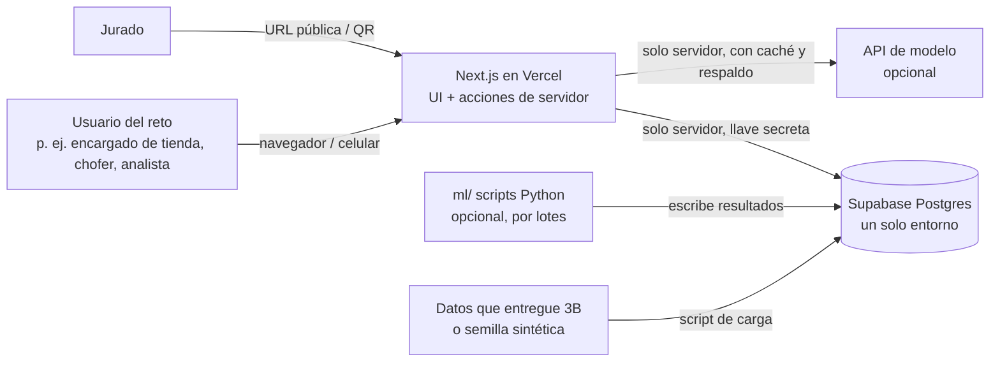

# Arquitectura provisional — Hackathon Tiendas 3B

> Estado: **provisional** · decidida en S000 (2026-11-17) · se ratifica o se supera en S001, a las 10:00 del sábado, con el reto en la mano.
> Verificado: el andamiaje `I0` se construyó y midió en S000 (lint, build, fronteras en rojo, `/salud` local); nada desplegado todavía. Lo marcado `[INVESTIGADO]` salió de fuentes del 17-nov-2026; lo marcado `[SUPUESTO]` no se ha medido.

## 1. Propósito y alcance

Construir en **7 h netas** (9:30–17:00, con comida a las 13:30) un MVP funcional que resuelva el reto elegido y se pueda demostrar en vivo desde una URL pública. Queda fuera todo lo que no se ve en la demo: usuarios reales, producción, operación, multi-entorno.

## 2. Restricciones

- Un día, cinco personas, varios programando en paralelo con agentes.
- Stack decidido por el orquestador (S000): **Next.js + Supabase + Vercel + GitHub**; Python solo si el reto lo exige.
- Reglas del evento sobre código previo: no las mencionan → se lleva **plantilla previa** (andamiaje `I0`, sin producto). Si la prohíben a las 9:00, se declara.
- Presupuesto: capas gratuitas + saldo pequeño de API de modelo.

## 3. Metas de calidad (escenarios con medida)

| # | Escenario | Cómo se comprueba |
|---|---|---|
| Q1 | **Demo:** un integrante recorre el camino dorado completo en ≤ 3 min, sin errores, 3 veces seguidas, en laptop y en un celular | Cronómetro + lista de pasos del guion; desde las 13:15 se corre tras cada integración |
| Q2 | **Despliegue:** un merge a `main` está en la URL pública en < 5 min y se revierte en 1 clic | `/salud` muestra el SHA corto de `main`; se cronometra en `I0` |
| Q3 | **Resiliencia:** si cae el wifi del recinto, la demo se da igual | Ensayo con hotspot de celular + app en local con la misma semilla + video de respaldo grabado a las 16:15 |
| Q4 | **Paralelismo:** tres carriles integran cada ~60 min sin conflictos fuera de su carpeta | Cada merge toca solo carpetas del carril; el contrato compartido lo edita solo el integrador |
| Q5 | **Credibilidad:** toda cifra del pitch tiene fuente (3B o medición propia en la demo) | Tabla «cifra → fuente» en el guion del pitch |

## 4. Contexto y contenedores

Fronteras de confianza: el navegador (todo lo que llega de ahí se valida en servidor) y los datos que entregue 3B (son confidenciales: no van a un repo público ni a servicios no autorizados).

## 5. Decisiones que dan forma (ADR exprés)

| ID | Decisión | Por qué | Qué la haría cambiar |
|---|---|---|---|
| H-01 | Next.js (App Router, TypeScript) + Tailwind + shadcn/ui · Supabase · Vercel | Es el stack que el orquestador domina; despliegue por push; cero infraestructura | El reto exige otra cosa (p. ej. app nativa obligatoria) |
| H-02 | **Un solo entorno**: una base, un despliegue. La semilla es un script reproducible | No hay usuarios reales; dos entornos cuestan tiempo y no los ve el jurado | — |
| H-03 | **Datos solo desde servidor** (componentes y acciones de servidor con la llave secreta). RLS encendida sin políticas: nada es legible con la llave pública | Seguridad correcta sin gastar tiempo en escribir políticas | El reto pide tiempo real en cliente → políticas de solo lectura sobre una vista |
| H-04 | **Sin login.** Roles simulados con un selector «Ver como…» y se dice en el pitch | El login no da puntos y es el error típico de hackathon | El reto evalúa explícitamente autenticación |
| H-05 | **Monolito modular; carpetas = carriles.** `lib/dominio` es núcleo puro (sin Next ni Supabase) | Permite programar en paralelo sin pisarse y probar el algoritmo sin interfaz | — |
| H-06 | **La IA nunca es punto único de falla de la demo:** toda llamada a un modelo va por `lib/ia`, en servidor, con caché de las entradas del guion y respuesta de respaldo | Una API lenta o caída no puede tumbar el camino dorado | — |
| H-07 | **Móvil = web responsiva** que se abre con un QR | Sin builds ni tiendas; el jurado la prueba en su teléfono | El reto exige nativo **y** alguien del equipo domina Expo |
| H-08 | **Python por lotes, no como servicio:** si hay optimización o pronóstico pesado, un script en `ml/` calcula y escribe a la base; la web solo lee | Evita desplegar y mantener un segundo servicio en un día | Se necesita recalcular en vivo frente al jurado → función Python o servicio aparte, decidido antes de las 10:30 |
| H-09 | **Tronco único:** `main` siempre desplegable; ramas cortas por carril; un solo integrador | Ver §8 de las instrucciones | — |

## 6. Módulos y reglas de dependencia

| Carpeta | Dueño (carril) | Puede importar | No puede importar | Comprobación |
|---|---|---|---|---|
| `app/`, `components/` | UI | `lib/contrato`, acciones de `lib/datos` | cliente de Supabase directo, `lib/ia` directo | ESLint `no-restricted-imports` (se instala en `I0` y se prueba en rojo una vez) |
| `lib/dominio/` | Núcleo | `lib/contrato` | `next/*`, `@supabase/*`, `app/` | misma regla + sus pruebas corren sin base |
| `lib/ia/` | Datos e IA | `lib/contrato` | `app/` | ESLint impide que `app/` y `components/` lo importen |
| `lib/datos/`, `supabase/`, `datos/` | Datos e IA | `lib/contrato`, `lib/dominio` | `app/` | — (revisión a ojo) |
| `lib/contrato/` (tipos y formas compartidas) | **Integrador, solo él** | nada | todo | cualquier cambio ajeno a este archivo es hallazgo |
| `ml/` (opcional) | Datos e IA | — | — | — |

## 7. Conceptos transversales

- **Errores:** el camino dorado nunca muestra un error crudo; cada pantalla tiene estado vacío, cargando y fallo.
- **Semilla:** `datos/semilla/` con datos realistas (productos tipo 3B, colonias y tiendas plausibles). Reinstalable con un comando; es parte de la demo.
- **Salud:** ruta `/salud` que muestra SHA desplegado y un conteo de la base. Es el instrumento de Q2.
- **Secretos:** solo en variables de entorno de Vercel y `.env.local`; `.env.example` lleva nombres sin valores.

## 8. Riesgos y respuesta

| Riesgo | Respuesta |
|---|---|
| Wifi del recinto lento o caído | Hotspot de dos celulares; app en local; video de respaldo (Q3) |
| Límites de uso del asistente con varios programando | Cada programador con su propia cuenta; un modelo alterno acordado; misiones largas en vez de muchos mensajes |
| Vercel bloquea despliegues de commits de colaboradores en repo privado con plan Hobby `[INVESTIGADO]` | **Resuelto en S000: repo público** sin secretos ni datos de 3B; se confirma con el push de prueba de un compañero en `I0.1` |
| Supabase gratuito: máximo 2 proyectos activos y pausa por inactividad `[INVESTIGADO]` | Crear el proyecto el viernes y confirmar que está activo el sábado a las 7:00 |
| Alcance inflado | Camino dorado único; congelar funciones a las 15:30 |
| Conflictos de merge | Carpetas por carril; contrato con un solo dueño; integración cada ~60 min |
| Los datos de 3B llegan en un formato inesperado | El carril de datos empieza por ahí; semilla sintética lista como plan B |

## 9. Pospuesto, con su disparador

| Qué | Disparador que obliga a decidir |
|---|---|
| Proveedor de mapas y de ruteo | El reto tiene componente geográfico (decidir en F1) |
| Servicio Python en vivo | H-08 |
| App nativa | H-07 |
| Login real | H-04 |
| Modelo de IA y proveedor exacto | Al crear la llave en el checklist previo |

## 10. Reglas no verificables (se revisan a ojo en cada integración)

Que nadie edite `lib/contrato` salvo el integrador · que no haya secretos en el repo (se corre `guardia-credenciales` antes de hacerlo público o de entregarlo) · que los datos de 3B no estén versionados.
